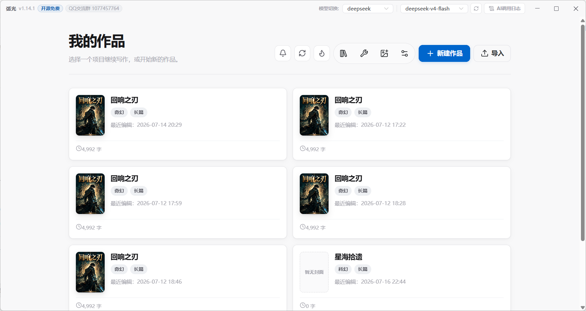
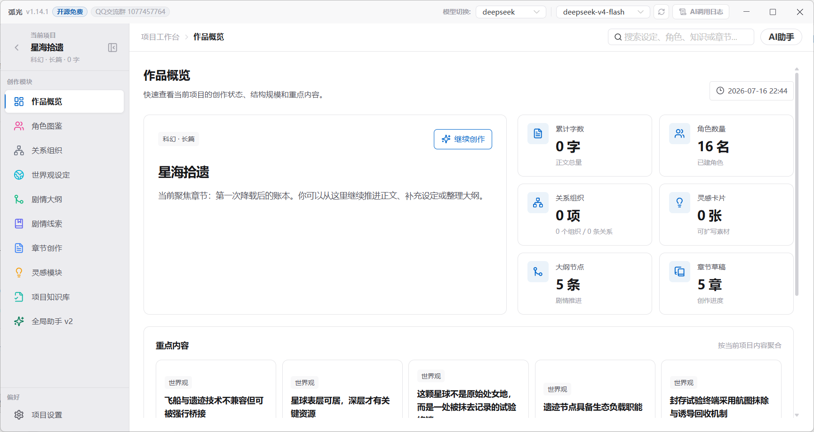
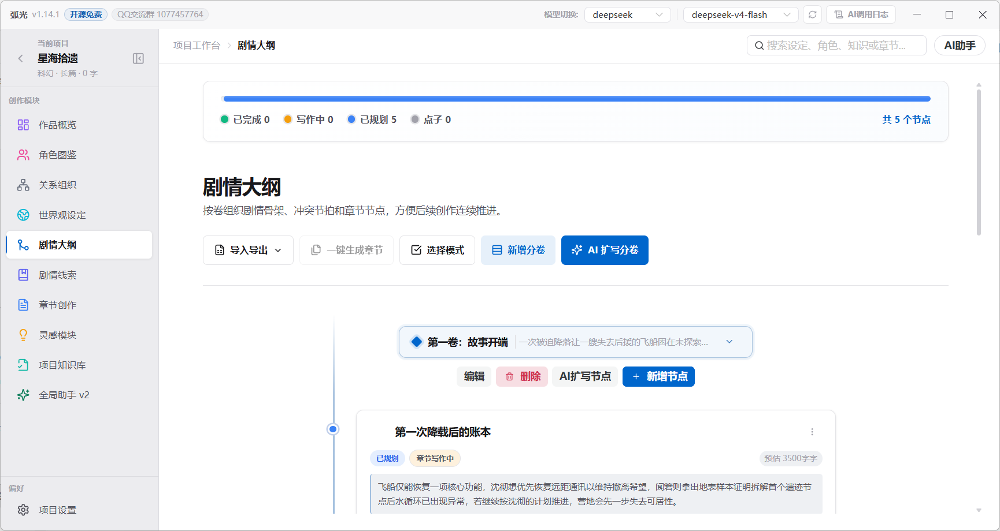
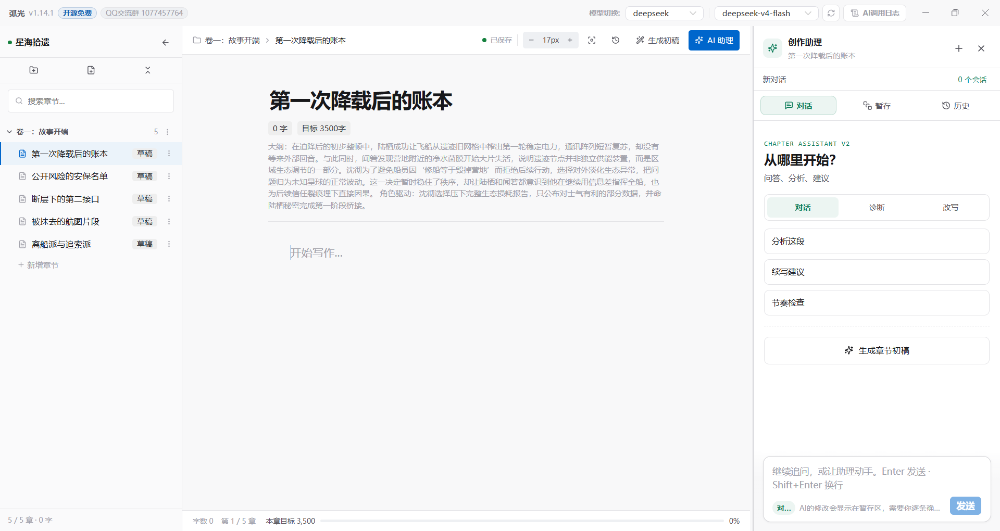
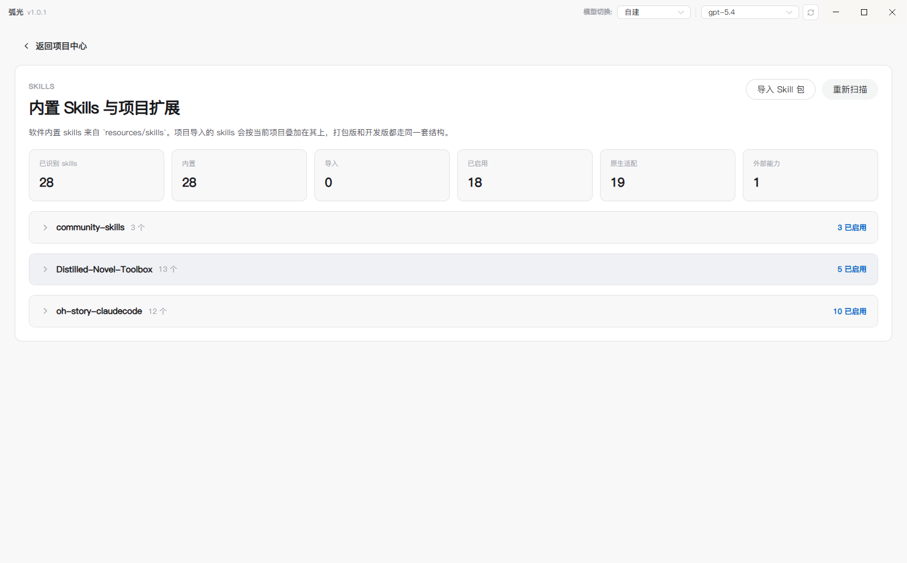
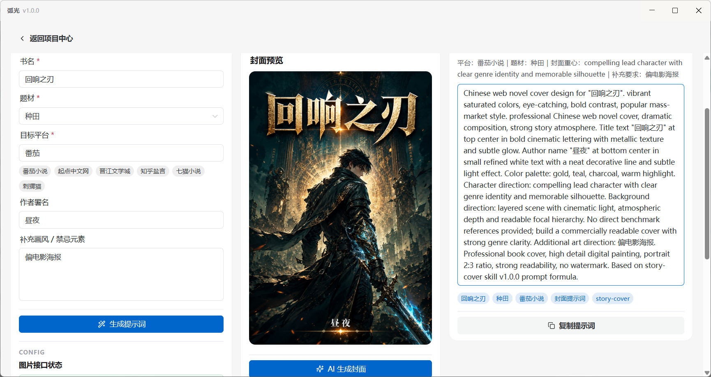

<div align="center">


# CharacterArc · 弧光

**本地优先的 AI 小说创作桌面应用**

<p>
  
  
  
</p>

<p>
  📘 <a href="https://ecnnfa0ullkb.feishu.cn/wiki/CuMxwE8xwiZyIkkYDDfcdmpjnRe?from=from_copylink"><strong>图文使用教程</strong></a>
</p>

</div>

---

## 这是什么

一个围绕**章节写作**组织起来的桌面工作台：项目数据全部存在本机 SQLite，你维护角色、世界观、大纲与正文，AI 负责初稿、润色、审校与去 AI 味。

稿件不锁定、不上传，AI 能力需自备模型接口或使用本机 Codex CLI。

## 快速开始

需要 **Node.js 22+** 与 **pnpm 10+**（仓库锁定 `pnpm@10.33.2`）。

```bash
pnpm install
pnpm run dev        # 开发模式
pnpm run build      # 类型检查 + 构建
pnpm test           # 单元测试
```

打包安装包需在目标平台执行：

```bash
pnpm run dist:win   # Windows
pnpm run dist:mac   # macOS（需在 macOS 上跑）
```

## 配置 AI

在「设置」里配置，可保存多套并在顶栏快速切换。

| 类型 | 说明 |
|---|---|
| **文本生成** | OpenAI 兼容协议（DeepSeek、通义、智谱、Kimi、Ollama…）或 Anthropic 协议；填 Base URL + Key + 模型名 |
| **Codex CLI** | 复用本机登录状态，无需 API Key，可自动查找路径、拉取模型、设推理强度 |
| **图像生成** | 最多 8 套渠道全局生效，封面工作台与资产卡生图共用；支持 GRS 与 OpenAI Images 两种协议 |

Key 存在本机数据库，**以明文保存**——请勿在共用机器上使用。

## 功能

**工作台**（项目内 9 个面板）

作品概览 · 关系组织 · 世界观设定 · 剧情大纲 · 剧情线索 · 章节创作 · 灵感模块 · 项目知识库 · 全局助手 v2

**独立页面**

资产库（角色/道具/场景的沉淀与生图）· Prompt 中心（只读查看各功能真实 prompt）· 封面工作台 · 番茄榜单 · 续写导入 · Skill 管理

**章节创作**

三栏布局（目录树 + TipTap 编辑器 + AI 侧边栏）· 按大纲建章并自动带入标题/摘要/字数目标 · 自动保存与历史快照回滚 · 阅读/专注模式 · 导出 `.txt` / `.docx`

**AI 能力**

章节初稿流程（写作备忘 → 初稿 → 审计 → 自动修复/去 AI 味 → 写作日志）· Agent Loop（按 Skill 索引与工具注册表循环思考）· 多厂商接入与 reasoning 字段隔离 · 任务进度面板

**内置 Skill**

`resources/skills/` 下 3 组共 28 个 Skill（`oh-story-claudecode` 13 / `Distilled-Novel-Toolbox` 13 / `community-skills` 2），也可为单个项目导入额外 Skill 包。

## 数据存放

| 内容 | 路径 |
|---|---|
| 数据库（SQLite） | `<userData>/data/workspace.db` |
| 资产图片 | `<userData>/asset-images/<projectId>/` |
| 项目级 Skill | `<userData>/project-skills/<project-scope>` |

内容不上传任何第三方服务，但 AI 请求会发给你自己配置的模型服务。

## 界面预览

<table>
  <tr>
    <td width="50%" align="center">
      <a href="docs/assets/homepage.png"></a>
      <br /><sub><b>项目中心</b> · 集中管理所有小说项目</sub>
    </td>
    <td width="50%" align="center">
      <a href="docs/assets/overview.png"></a>
      <br /><sub><b>项目概览</b> · 设定资产与章节进度</sub>
    </td>
  </tr>
  <tr>
    <td width="50%" align="center">
      <a href="docs/assets/story_line.png"></a>
      <br /><sub><b>剧情大纲</b> · 双栏交错时间线，拖拽排序与 AI 扩写</sub>
    </td>
    <td width="50%" align="center">
      <a href="docs/assets/chapter_creation.png"></a>
      <br /><sub><b>章节创作</b> · 目录树 + TipTap 编辑器 + AI 侧边栏</sub>
    </td>
  </tr>
  <tr>
    <td width="50%" align="center">
      <a href="docs/assets/skills_show.png"></a>
      <br /><sub><b>Skill 系统</b> · 启用内置或项目级扩展 Skill</sub>
    </td>
    <td width="50%" align="center">
      <a href="docs/assets/cover_design.png"></a>
      <br /><sub><b>封面工作台</b> · 多平台封面 Prompt 与历史版本对比</sub>
    </td>
  </tr>
</table>

## 技术栈

Electron 37 · Vue 3.5 · TypeScript 5.9 · electron-vite (Vite 7) · Naive UI · Pinia · TipTap · Cytoscape · SQLite · Vercel AI SDK

## 自动发布

`.github/workflows/release.yml` 在 `v*` tag 推送或手动触发时构建，产物上传到 Actions artifacts：

- **macOS** — arm64 / x64，ad-hoc 签名未公证
- **Windows** — x64 / arm64，NSIS 安装包
- **Linux** — x64 / arm64，AppImage 与 deb

正式对外分发 macOS 需在仓库补 `CSC_LINK`、`CSC_KEY_PASSWORD`、`APPLE_ID`、`APPLE_APP_SPECIFIC_PASSWORD`、`APPLE_TEAM_ID` 并启用公证。

## 开发文档

- `CLAUDE.md` — 架构说明
- `AGENTS.md` — AI 代理工作规则
- `CHANGELOG.md` — 变更记录
- `announcements.json` — 应用内升级公告

## 鸣谢

- [oh-story-claudecode](https://github.com/worldwonderer/oh-story-claudecode) — 核心写作 Skills 的方法论基础
- [dama-cyber/Distilled-Novel-Toolbox](https://github.com/dama-cyber/Distilled-Novel-Toolbox) — 小说工作流与创作辅助方向参考

## License

[MIT](./LICENSE) © zhouyeshan
